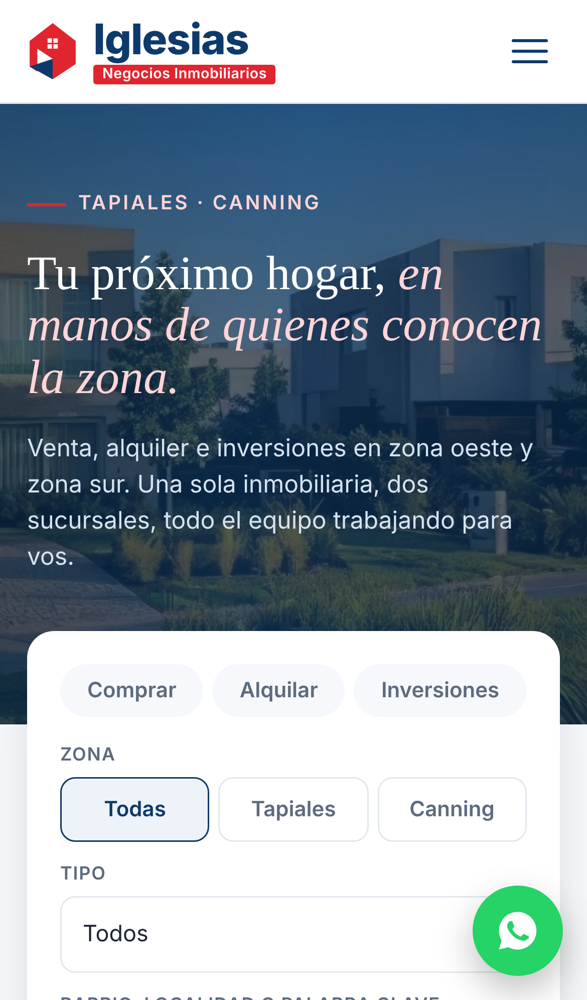

# Iglesias Negocios Inmobiliarios — Web unificada (prototipo)

Propuesta de diseño para unificar en **una sola web** las sucursales de **Tapiales** y **Canning**, en lugar de la portada dividida actual.

## Qué funciona

- **Buscador y filtros:** operación (comprar, alquilar, inversiones), zona (Tapiales / Canning), tipo y texto libre. Los links del menú, de los servicios y de las sucursales aplican el filtro que corresponde.
- **Listado de propiedades** generado desde `js/app.js` (`PROPIEDADES`). Para sumar una propiedad, agregás un objeto a esa lista.
- **Favoritos** (♡), que se guardan en el navegador.
- **Galería de fotos** con visor a pantalla completa y navegación con flechas.
- **Contacto real:** WhatsApp de Canning (11 5954-5500), teléfono y email de Tapiales, y "Cómo llegar" en Google Maps.
- **Formulario de tasación:** con zona Canning abre WhatsApp con el mensaje armado; con Tapiales abre un email a info@iglesiasprop.com.
- **Diseño responsive** con menú hamburguesa en celular.

## Publicar con GitHub Pages

Settings → Pages → *Build and deployment* → Source: **Deploy from a branch** → Branch: **main** / **(root)** → Save.
En 1 o 2 minutos queda en `https://lolosannn.github.io/iglesias-propiedades/`.

## Cómo verlo

- **`Iglesias-boceto-web.html`**: archivo único con las fotos incluidas. Se abre con doble clic en cualquier navegador y se puede compartir tal cual.
- **`index.html` + `js/` + `img/`**: el sitio, que es lo que publica GitHub Pages.
- **`build_standalone.py`**: regenera el archivo único después de cambiar el sitio (`python3 build_standalone.py`).
- **`docs/preview.png`**: captura de la página completa.

## Idea principal

La zona deja de ser una puerta de entrada y pasa a ser un **filtro**: en el buscador (Todas / Tapiales / Canning), con una etiqueta en cada propiedad y una sección propia para cada sucursal. Es una sola marca, con dos equipos, dos teléfonos y dos matrículas.

## Secciones

1. Barra superior con las dos sucursales y el horario
2. Portada con buscador (operación, zona, tipo, barrio, precio)
3. Servicios: Venta, Alquiler, Inversiones, Tasaciones
4. Propiedades destacadas, con filtro por zona
5. Ficha de muestra Canning: casa a estrenar en Barrio La Magdalena
6. Ficha de muestra Tapiales: casa en 2 plantas en Ciudad Madero
7. Sucursales: "Una inmobiliaria, dos zonas"
8. Cifras
9. Nosotros y servicios: para propietarios, inversores y desarrolladores
10. Tasaciones, con formulario
11. Opiniones
12. Pie con los datos de ambas sucursales

## Pendiente / datos de ejemplo

- Fotos faltantes de Tapiales (living y cocina)
- Precios, dormitorios, baños y metros de las propiedades de muestra
- Dirección de la sucursal Canning y números de matrícula
- Cifras ("25+ años", "1.500 operaciones") y reseñas: son de ejemplo
- Logo: está redibujado en SVG; reemplazarlo por el archivo original
- Envío del formulario a una casilla sin pasar por WhatsApp o email (por ejemplo, con Formspree)
